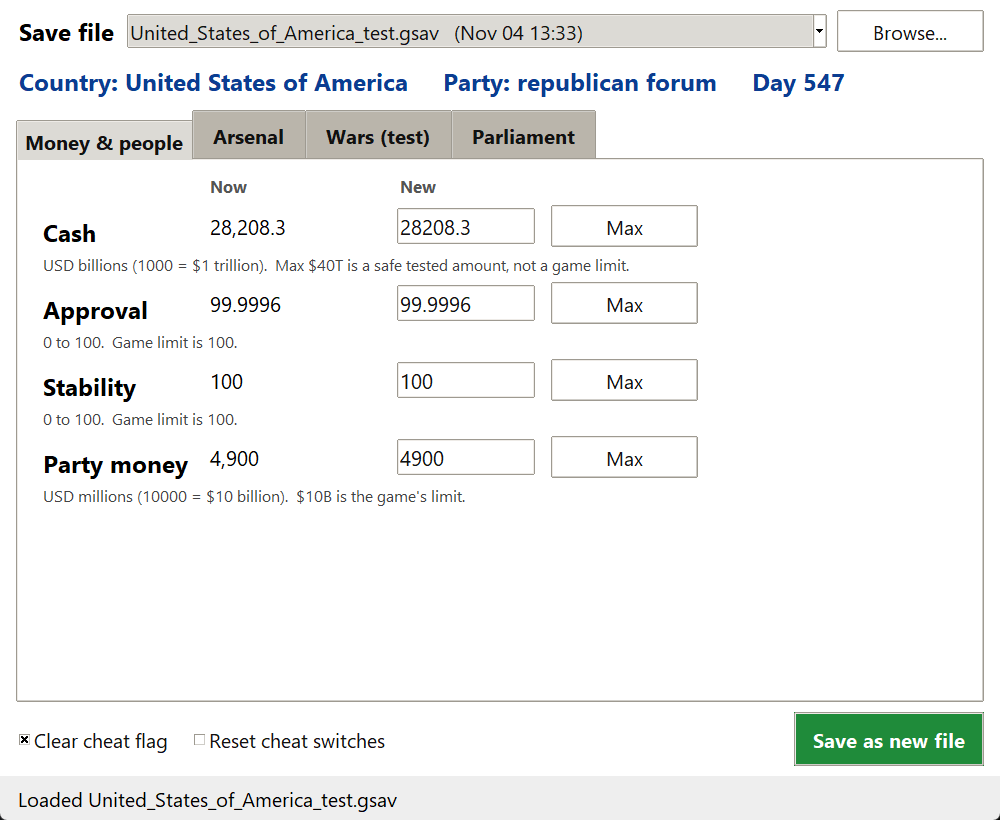
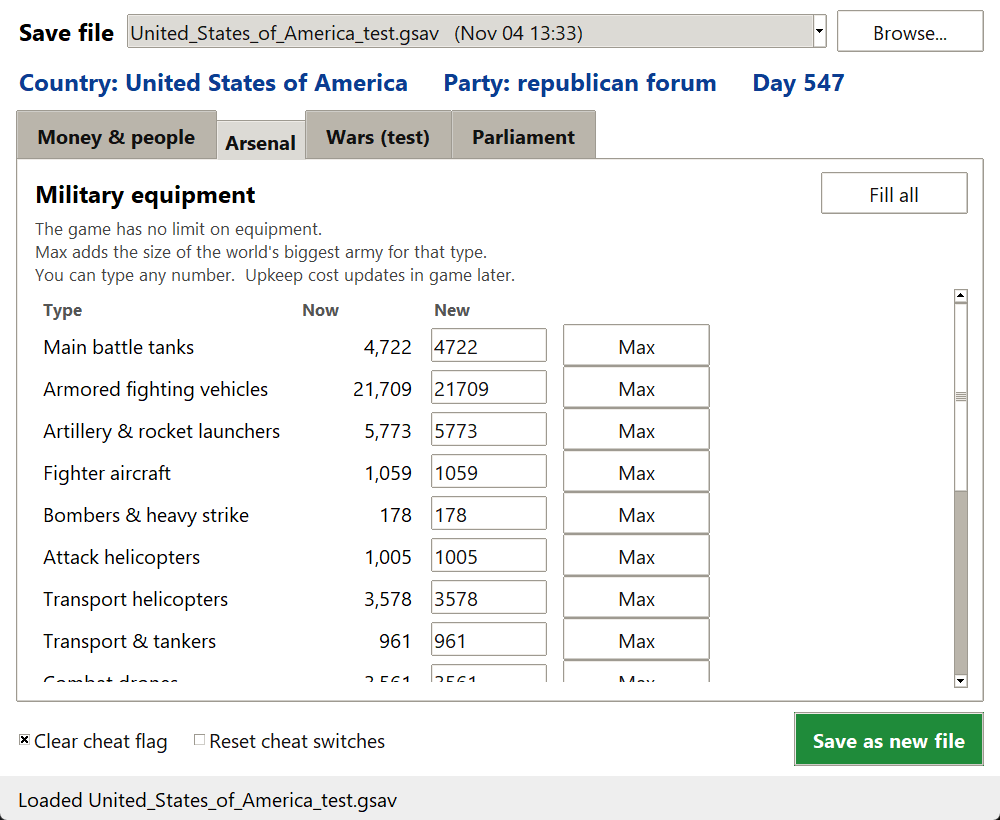

# Geoplanetical Save Editor

A small, simple save editor for **Geoplanetical**.

> **Unofficial fan tool.** Not made by, supported by, or affiliated with Polytale Games.
> Use at your own risk.



## Safety first

- **Your save is never changed.** Every time you press *Save as new file*, the editor writes a
  brand new file next to it named `Mira_edit_001.gsav`, `Mira_edit_002.gsav`, and so on.
  It never overwrites anything.
- **Back up your saves anyway.** Copy your saves folder somewhere safe before you start.
  Saves are in `%APPDATA%\Geoplanetical\saves` The editor finds it on its own.
- If something goes wrong, a message tells you and nothing is saved.

## How to run

1. Install Python 3.10 or newer from python.org (tick "Add Python to PATH"). Nothing else is needed.
2. Close the game, or go to the main menu.
3. Double-click **`Geoplanetical Save Editor.bat`** (or run `pythonw save_editor.pyw`).
4. At the top, pick your save. The newest one is picked for you. *Browse...* opens any other.
5. Change what you want, then press the green **Save as new file** button.
6. Wait for the "Saved" message. It shows the new file name.
7. In the game, load that `Mira_edit_...` save.

Tip: to use a different saves folder, run `pythonw save_editor.pyw --saves "D:\some\folder"`.

## What each tab does

**Money & people** - Cash (in billions of dollars, 1000 = 1 trillion), Approval, Stability,
and Party money (in millions, 10000 = 10 billion).

**Arsenal** - Your military equipment: tanks, planes, ships, drones, missiles and more.
Type a new number for any type. *Fill all* adds a lot of everything.
If you have 0 of something you can still add it: the editor makes new stock using your
country's best model, just like the game's own `add_equipment`. Ships need a navy (a coast);
"no navy" means ships cannot be added.



**Wars (test)** - Shows your wars and lets you add a country to a side.
This is **experimental**. Keep your old save.

**Parliament** - Shows each chamber's seats.
- *Fill parliament with my ruling party*: your party gets every seat in every chamber.
  Seats reset at the next election (or if parliament is dissolved).
- *Set my party support to* + slider (1-99, 70 is a good start): how popular your party is with
  voters. All parties always add up to 100%; the others shrink in proportion. After loading, the
  number slowly drifts with how happy voters are, so a good economy keeps it up.
- Tick both to get full seats now **and** keep winning the next election.

## How Max works

- **Cash:** Max is $40T. That is a safe tested amount, not a game limit.
- **Party money:** $10B is the game's own limit.
- **Approval and Stability:** the game's limit is 100.
- **Arsenal:** the game has no limit. Max adds the size of the world's biggest army for that type.
  You can type any number.

## Good to know

- **Clear cheat flag** is on by default. Leave it on.
- **Reset cheat switches** turns off any console cheat toggles stored in the save.

## Self-test (optional)

```
python test_core.py path\to\a_copy_of_a_save.gsav
```

It works on a temporary copy and never changes the file you point at.
With no save given it just says SKIPPED. You can also set `GSAV_TEST_SAVE` to a save path.

## Files

- `save_editor.pyw` - the window
- `gsav_core.py` - reads, checks and writes saves
- `tabs\` - one file per tab (drop in a new file with `TITLE` and `build(app, frame)` to add a tab)
- `country_names.json`, `equipment_classes.json` - data the editor needs

## Credits

Made by Antilitist and the Grok Bot crew. MIT License, see `LICENSE`.